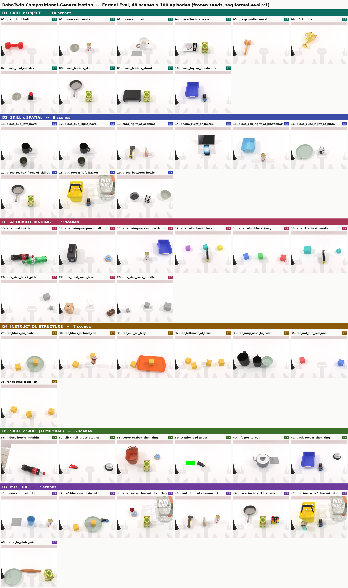

# ManipScope

A RoboTwin-based benchmark for compositional generalization in robotic manipulation.
ManipScope separates the simulation/evaluation loop from model inference adapters.
The bundled **formal48-v1** suite contains **48 scenes**, **100 frozen seeds per scene**,
and six composition axes: skill × object, skill × spatial relation, attribute binding,
reference structure, temporal skill composition, and mixed composition.



## Quick start

Use Linux with a compatible NVIDIA driver and an isolated simulation environment.
Model checkpoints and RoboTwin assets are external downloads, not part of this repository.

```bash
python3 -m pip install -r requirements/dev.txt
python3 tools/validate_repo.py
python3 -m pytest -q tests
cp configs/local.env.example configs/local.env
# Edit configs/local.env for your machine and selected backend.
python3 tools/link_assets.py /absolute/path/to/robotwin_assets
# Validate inputs without starting a simulation or model:
DRY_RUN=1 bash suite/run_suite.sh dm05 move_can_coaster
# After installing opendm and setting DM05_MODEL, OPENDM_DIR, OPENDM_ENV:
EPISODES=1 RUN_NAME=smoke_dm05 bash suite/run_suite.sh dm05 move_can_coaster
```

See [installation](docs/INSTALLATION.md) before the first simulation run.
A dry run checks configuration and benchmark inputs; it does not check GPU compatibility.

## Evaluation contract

- Default: 50 episodes per scene, `demo_clean`, unseen instructions.
- Frozen seeds are used in file order; requesting more seeds than available fails early.
- Each seed determines the instruction sampling. Actual instructions are recorded.
- The first 10 evaluated seeds are eligible for head-camera video, independent of outcome.
  Set `ROBOTWIN_VIDEO_FIRST_N`; `MAX_SUCC_VIDEOS`/`MAX_FAIL_VIDEOS` are additional caps.
- Generated scenes check target selection, goal completion, and reference-object stability.
  Handwritten scenes retain their task-specific criteria.
- A common evaluator does not imply identical action spaces, inference budgets, or training data.
  Report these alongside success rates; see [evaluation](docs/EVALUATION.md).
- The checked-in scene implementations and `suite/scenes_v2.yaml` define this frozen release.
  Generators produce development candidates under `out/`; do not blindly replace the release.

## Repository

- `envs/`: RoboTwin environments, common composition engine, and vendored cuRobo.
- `description/`: object descriptions and task instruction pools (regular files, no external links).
- `suite/scenes_v2.yaml`, `suite/seeds/`: formal membership and reproducible episode seeds.
- `suite/policies.yaml`, `policy/`: public model registrations and adapters.
- `suite/run_suite.sh`: sequential evaluation; parallel/retry wrappers are also included.
- `tools/`, `tests/`: preflight, provenance, release validation and regression tests.
- `docs/archive/`: historical reports; not evidence of this normalized snapshot's performance.

## Documentation

- [Installation](docs/INSTALLATION.md) and [backend configuration](docs/BACKENDS.md)
- [Evaluation and results](docs/EVALUATION.md)
- [Scene catalog](docs/SCENES.md)
- [Development and frozen protocol](docs/DEVELOPMENT.md)
- [Optional external EEF agent](docs/EXTERNAL_AGENT.md)
- [Normalization and validation status](docs/NORMALIZATION.md)
- [Contributing](CONTRIBUTING.md), [security](SECURITY.md), [third-party notices](THIRD_PARTY_NOTICES.md)

## Attribution and license

This project derives from RoboTwin and retains the original MIT notice in [LICENSE](LICENSE).
The vendored `envs/curobo` snapshot has its own [NVIDIA license](envs/curobo/LICENSE)
and [asset license](envs/curobo/LICENSE_ASSETS). These are not replaced by the root MIT license.
External assets, models and inference backends retain their respective terms.
No model weights, API credentials, private backend, or original repository Git history are bundled.
